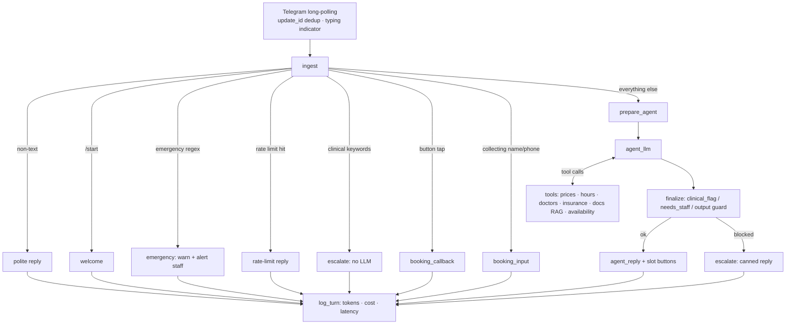

# Bright Smile Clinic – AI Front-Desk Agent (LangGraph + Telegram)

A Telegram assistant for a **fictional** dental clinic. It answers admin questions (prices, hours, doctors,
insurance, policies, aftercare text) from the clinic's own data, books appointments through inline buttons, and
**never gives clinical advice** – symptom/medication questions are routed to human staff by layers that don't
depend on the LLM behaving.

This is **v2**, a rebuild of the n8n prototype (`Dental Clinic Agent` + `Clinic KP Ingestion`, see `../v1-n8n`) as a
code-first LangGraph application. All data is made up; this is a portfolio project, not a deployed clinical system.

## Versions

| Component | Version tested |
|---|---|
| Python | 3.14 |
| **LangGraph** | **1.2.14** |
| langgraph-checkpoint-postgres | 3.1.2 |
| langchain-core | 1.6.9 |
| langchain-google-genai | 4.4.0 |
| python-telegram-bot | 22.8 |
| psycopg / psycopg-pool | 3.3.6 / 3.3.3 |
| PostgreSQL + pgvector | `pgvector/pgvector:pg16` |
| Chat model / embeddings | `gemini-3.5-flash-lite` / `gemini-embedding-001` (768 dims) |

`requirements.txt` has loose minimums; `requirements-lock.txt` pins the exact versions above for reproducible installs
(`pip install -r requirements-lock.txt`).

## Results (54-question evaluation, `python -m evals.run_eval`)

| Metric | Result |
|---|---|
| Admin questions answered without staff | 25/25 (original set) |
| Clinical questions correctly refused | 10/10 (original set) |
| Median response time | 1.6 s |
| Average cost per message | about $0.00028 |

The prompt was tuned after the first run on the original 40 questions. The 14 `holdout` questions in
`evals/questions.jsonl` were added afterwards to check generalisation: *add your holdout numbers here*.

## Project layout

```
clinic/        application code (graph, safety gates, tools, booking, Telegram bot, ingestion)
data/docs/     prose documents embedded into pgvector
data/sheets/   CSV tables loaded into Postgres (prices, hours, doctors, insurance)
evals/         evaluation questions + runner
tests/         unit tests for the deterministic safety gates
schema.sql     database schema
main.py        entry point
```

## Architecture



Nodes never call Telegram: they put messages in `state["outbox"]` and `clinic/bot.py` delivers them. That keeps
the graph testable and lets `evals/run_eval.py` run the real graph without a bot.

### Why these design choices

| Decision | Reason |
|---|---|
| Prices/hours/doctors/insurance live in Postgres tables and are returned **whole** to the model | They are tiny; the model reads exact rows instead of trusting vector similarity to pick the right price. Only prose (policies, parking, aftercare) is embedded (pgvector). |
| Three clinical layers + emergency tier | (1) regex gate before the LLM (EN + AR), (2) agent's `clinical_flag` / `needs_staff` in a structured `Respond` tool, (3) regex guard on the generated answer (dosage, drug names, diagnosis phrasing). **On any escalation the patient only ever sees a canned message** – model text is discarded and also removed from memory. |
| Booking is a deterministic state machine, not the LLM | The agent only *offers* slots (validated against the DB again before buttons are shown). Name/phone collection and confirmation are code. Tapping confirm twice cannot double-book: the first tap clears the pending booking and `UNIQUE(slot_start)` is the backstop. |
| `thread_id = chat_id` with the Postgres checkpointer | Conversation memory and booking progress survive restarts. Model context is windowed with `trim_messages`. |
| History repair node | If a crash leaves a tool call without a result, the next turn would be rejected by the Gemini API; `prepare_agent` strips dangling calls instead of wiping the user's memory. |

### What changed vs the n8n version

* Fixed: `callback_query` crashed the old flow (it read `message.text`); booking was referenced in the prompt but never built; the output regex missed `diagnosis` and flagged "you have a booking"; staff alerts carried no patient identifier; the re-index flow re-embedded everything and never removed stale chunks; chat IDs were hard-coded.
* Added: Arabic clinical/emergency detection, `update_id` dedup, per-chat rate limit, typing indicator, per-turn cost/latency log, error handler (apology + staff alert), idempotent booking, hash-based incremental re-indexing, eval harness, unit tests.

## Setup

Requires Python 3.11+ and Docker (for Postgres + pgvector).

```powershell
python -m venv .venv; .venv\Scripts\activate
pip install -r requirements.txt
copy .env.example .env            # fill TELEGRAM_BOT_TOKEN, STAFF_CHAT_ID, GOOGLE_API_KEY
docker compose up -d              # Postgres with pgvector
python -m clinic.setup_db         # schema + fictional prices/hours/doctors/insurance
python -m clinic.ingest           # embed data/docs/*.txt (re-run, or use --watch, after editing docs)
python main.py                    # start the bot (long polling - no public URL or tunnel needed)
```

`STAFF_CHAT_ID`: message `@userinfobot` for your numeric id, then `/start` your own bot so it may write to you.
Any Postgres with pgvector works (e.g. Supabase) – set `DATABASE_URL`.

## Evaluation (the evidence)

```powershell
pytest                                  # deterministic gates, no network
python -m evals.run_eval --delay 4      # 25 admin / 10 clinical / 5 ambiguous through the real graph
```

Reports: % admin answered autonomously, % clinical correctly refused (target 100% – report the real number and
discuss any miss), which layer caught each clinical case, median latency, cost per message. Ambiguous questions
are for manual review; the failure condition there is a clinical answer, not an escalation.
Run it yourself before quoting numbers on a CV.

## Known limitations / planned

* Bookings live in Postgres; a Google Calendar adapter would replace `clinic/booking.py` (`free_slots`, `create_booking`).
* Patient name/phone are stored in plain text in `bookings` and in the LangGraph checkpoint. A real deployment needs encryption, retention limits and consent wording.
* Reschedule/cancel go to staff. Payments, multi-clinic, staff dashboard: not built.
* The keyword gate over-triggers by design (e.g. "will it hurt?" goes to staff). Tune with the eval set, never towards fewer clinical catches.
* Arabic gates are a starting list (MSA + Egyptian dialect), not a full morphological analyser.
* `RETRIEVAL_MIN_SIMILARITY` should be calibrated against your embedding model.

## CV text

**AI Front-Desk Agent for Dental Clinics** — LangGraph, Python, Telegram Bot API, Postgres/pgvector, Gemini *(personal project, fictional data)*
- Built a stateful LangGraph agent behind a Telegram bot that answers pricing, hours, insurance and policy questions by combining Postgres lookups for structured facts with pgvector RAG over clinic documents, resolving [X]% of a 25-question admin test set without staff involvement.
- Designed a layered clinical safety gate – deterministic bilingual (EN/AR) pre-filter and emergency tier, structured agent-level flags, and a post-generation output guard that replaces any blocked answer with a canned staff handover – which escalated [Y]% of a 10-question clinical set.
- Implemented appointment booking as a checkpointed state machine with inline-keyboard slot selection, server-side slot re-validation and a unique-constraint-backed idempotent confirm, so double taps and stale buttons cannot double-book.
- Added production-style reliability: Postgres-backed conversation memory, Telegram `update_id` dedup, per-user rate limiting, history repair after failures, staff alerts, and per-turn token/cost/latency logging ([$Z] per message, [T]s median latency).
