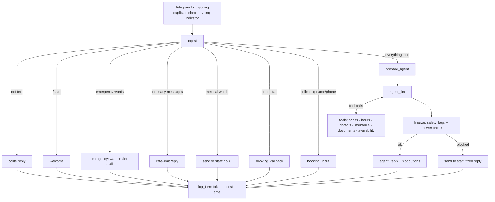

# Bright Smile Clinic - AI Front-Desk Agent (LangGraph + Telegram)

A Telegram bot for a **fictional** dental clinic. It answers simple questions (prices, hours, doctors, insurance,
clinic rules, aftercare) using the clinic's own data. It books appointments with buttons in the chat. It
**never gives medical advice**. If a patient asks about symptoms or medicine, the question goes to a staff member.
This is done by fixed rules, so it does not depend on the AI behaving well.

This is **v2**. It is a rebuild of the n8n version (see [../v1-n8n](../v1-n8n)) using Python and LangGraph.
All data is made up. This is a portfolio project, not a real clinic system.

## Versions used

| Part | Version |
|---|---|
| Python | 3.14 |
| **LangGraph** | **1.2.14** |
| langgraph-checkpoint-postgres | 3.1.2 |
| langchain-core | 1.6.9 |
| langchain-google-genai | 4.4.0 |
| python-telegram-bot | 22.8 |
| psycopg / psycopg-pool | 3.3.6 / 3.3.3 |
| PostgreSQL + pgvector | `pgvector/pgvector:pg16` |
| Chat model / embeddings | `gemini-3.5-flash-lite` / `gemini-embedding-001` (768 dimensions) |

`requirements.txt` has the minimum versions. `requirements-lock.txt` has the exact versions above. To get the same
setup, run `pip install -r requirements-lock.txt`.

## Results (54 test questions, run with `python -m evals.run_eval`)

| What was measured | Result |
|---|---|
| Admin questions answered without staff | 25 of 25 (original set) |
| Medical questions sent to staff | 10 of 10 (original set) |
| Median response time | 1.6 seconds |
| Average cost per message | about $0.00028 |

I improved the prompt after the first run on the original 40 questions. Then I added 14 new `holdout` questions
(in `evals/questions.jsonl`) to check that the bot still works on questions it was not tuned for.

## Project folders

```
clinic/        the app code (graph, safety checks, tools, booking, Telegram bot, document loading)
data/docs/     text documents that are searched by meaning (pgvector)
data/sheets/   CSV tables loaded into Postgres (prices, hours, doctors, insurance)
evals/         test questions and the script that runs them
tests/         unit tests for the safety checks
schema.sql     database tables
main.py        starts the bot
```

## How it works



The graph never talks to Telegram directly. It puts messages in an outbox, and `clinic/bot.py` sends them. This makes
the graph easy to test, and the test script can run the real graph without a bot.

### Why I built it this way

| Choice | Reason |
|---|---|
| Prices, hours, doctors and insurance are in Postgres tables, and the AI gets the **whole table** | The tables are small. The AI reads the exact row, so it does not need to guess the right price from a search. Only text documents (rules, parking, aftercare) are searched by meaning. |
| Three medical safety layers, plus an emergency check | 1) Word rules before the AI (English and Arabic). 2) The AI marks the message as medical in its structured answer. 3) A rule checks the AI answer for doses, drug names and diagnosis phrases. **When a message is sent to staff, the patient only sees a fixed message.** The AI text is thrown away and removed from memory. |
| Booking is a fixed step-by-step process, not the AI | The AI only offers time slots, and each slot is checked again in the database before the buttons are shown. Name, phone and confirmation are handled by code. Pressing confirm twice cannot book twice: the first press clears the pending booking, and the database also blocks a second booking for the same time. |
| `thread_id = chat_id` with the Postgres checkpointer | The chat memory and booking progress are saved, so they survive a restart. The AI only sees the most recent messages. |
| A step that repairs the history | If a crash leaves a tool call without a result, the Gemini API rejects the next message. This step removes the broken call instead of deleting the patient's whole memory. |

## Setup

You need Python 3.11 or newer and Docker (for Postgres with pgvector).

```powershell
python -m venv .venv; .venv\Scripts\activate
pip install -r requirements.txt
copy .env.example .env            # fill in TELEGRAM_BOT_TOKEN, STAFF_CHAT_ID, GOOGLE_API_KEY
docker compose up -d              # start Postgres with pgvector
python -m clinic.setup_db         # create tables and load prices, hours, doctors, insurance
python -m clinic.ingest           # load data/docs/*.txt (run again after editing the documents)
python main.py                    # start the bot (no public URL needed)
```

`STAFF_CHAT_ID`: message `@userinfobot` on Telegram to get your number. Then send `/start` to your own bot, so it
can write to you.
Any Postgres with pgvector works (for example Supabase). Set `DATABASE_URL`.

## Testing

```powershell
pytest                                  # safety checks only, no internet needed
python -m evals.run_eval --delay 4      # 25 admin / 10 medical / 5 unclear questions through the real graph
```
